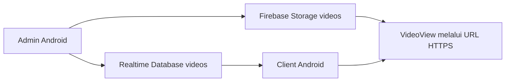

# Android Video Library

Dua aplikasi Java dalam satu repo: pengelola mengunggah dan mengatur video, sedangkan client menampilkan katalog dan memutarnya. Keduanya menggunakan satu Firebase project dan schema yang sama.

| Modul | Application ID | Pengguna |
| --- | --- | --- |
| admin | com.r.example.adminapp | Akun dengan custom claim admin=true. |
| client | com.r.example.movieapp | Akun Email/Password yang sudah login. |

## Alur yang tersedia



Admin memilih file melalui pemilih dokumen sistem, mengisi judul/deskripsi, lalu mengunggahnya. Sesudah upload selesai, aplikasi mengambil download URL HTTPS dan menyimpan metadata. Admin dapat mengubah detail dan menghapus video dengan konfirmasi.

Client mempunyai registrasi/login, daftar realtime berisi judul/deskripsi, logout, dan layar pemutar dengan MediaController. Area VideoView kosong pada item lama sudah diganti item teks yang membuka player terpisah. Tidak ada fitur Cast, transcoding, thumbnail otomatis, pencarian, atau unduh offline.

## Build

Siapkan JDK 17, Android SDK 35, Build Tools 35.0.0, dan Android Studio yang mendukung AGP 8.8.2. Wrapper memakai Gradle 8.10.2. Minimum API 24, target API 34.

Buka folder repo di Android Studio dan biarkan IDE membuat local.properties. Untuk terminal, atur ANDROID_HOME ke SDK Anda:

```powershell
.\gradlew.bat :admin:assembleDebug :client:assembleDebug
.\gradlew.bat :admin:testDebugUnitTest :client:testDebugUnitTest
```

APK berada di admin/build/outputs/apk/debug/ dan client/build/outputs/apk/debug/. Dependency diunduh ketika cache belum tersedia.

Tanpa konfigurasi Firebase pribadi, kedua aplikasi tetap dapat dibuild dan menampilkan layar petunjuk. Activity memeriksa config sebelum mengambil instance Auth, Database, atau Storage.

## Siapkan Firebase pengujian

1. Buat project milik Anda dan daftarkan dua aplikasi Android sesuai tabel application ID.
2. Aktifkan Authentication Email/Password, buat Realtime Database beserta regionnya, lalu buat bucket Storage. Untuk Storage, periksa persyaratan paket Blaze pada [panduan resmi Storage](https://firebase.google.com/docs/storage/android/start).
3. Tinjau `database.rules.json` dan `storage.rules`, lalu terapkan pada layanan pengujian yang dipilih. Repo tidak men-deploy aturan otomatis.
4. Setelah database dan bucket tersedia, unduh ulang konfigurasi masing-masing aplikasi dari Project settings. Simpan tepat sebagai `admin/google-services.json` dan `client/google-services.json`. Plugin aktif per modul bila file tersedia. Kedua config harus berasal dari project yang sama dan cocok dengan application ID modulnya.
5. Pastikan `project_info.firebase_url` pada kedua config cocok dengan URL root Realtime Database di Console. Plugin menghasilkan resource `firebase_database_url` dari field tersebut. [Pemetaan Google Services](https://firebase.google.com/docs/android/google-services-plugin-and-file).
6. Pastikan config admin juga memuat bucket default yang baru dibuat. Mengunduh ulang setelah pembuatan bucket mencegah penggunaan config tanpa bucket. [Setup Storage Android](https://firebase.google.com/docs/storage/android/start).
7. Buat akun pengelola dan beri custom claim `admin=true` melalui Firebase Admin SDK pada server tepercaya. Login ulang setelah claim berubah. Aplikasi Android tidak dapat memberikan claim admin.
8. Build ulang, login pada admin, lalu upload video uji. Daftar/login akun biasa pada client dan buka video tersebut.

### Database regional atau non-default

URL harus diambil dari Console. Host us-central1 memakai `DATABASE_NAME.firebaseio.com`; lokasi lain memakai `DATABASE_NAME.REGION.firebasedatabase.app`. [Panduan lokasi database](https://firebase.google.com/docs/database/android/start).

Kedua MainActivity saat ini memakai `FirebaseDatabase.getInstance()` default. Bila config tidak menunjuk instance yang dipilih, unduh ulang config yang benar. Untuk pemilihan regional/non-default secara eksplisit, developer dapat memakai `FirebaseDatabase.getInstance(databaseUrl)` pada inisialisasi database di MainActivity admin dan client; gunakan URL root HTTPS yang sama, tanpa path `videos`. Ini arahan adaptasi, bukan opsi pengaturan yang sudah ada pada UI. [API instance dengan URL](https://firebase.google.com/docs/reference/android/com/google/firebase/database/FirebaseDatabase).

Kode Storage menggunakan bucket default dari config. Jika memilih bucket lain, SDK menyediakan `FirebaseStorage.getInstance("gs://BUCKET_NAME")`; sesuaikan seluruh pembuatan instance Storage admin secara konsisten, termasuk delete. Jangan mengganti bucket dengan URL download HTTPS. [Pemilihan bucket](https://firebase.google.com/docs/storage/android/start#use_multiple_cloud_storage_buckets).

Admin tidak menyediakan registrasi bebas atau pemberian hak admin. Akun tanpa claim hanya mendapat penjelasan izin dan tombol logout.

## Data dan berkas kode

File video ada di Storage videos/<uuid>.<ekstensi>. Metadata di Realtime Database videos/<id> berisi title, description, videoUrl, dan storagePath. videoUrl berupa HTTPS download URL; storagePath menyimpan lokasi untuk menghapus file. Firebase key tidak disalin menjadi field data.

| Lokasi | Tugas |
| --- | --- |
| admin/.../MainActivity.java | Pemeriksaan role, picker, upload/progress, cleanup bila metadata gagal, update dan delete. |
| admin/.../VideoInfo.java | Schema metadata; key ditandai Exclude. |
| admin/.../VideoAdapter.java | Daftar detail dan aksi berdasarkan posisi adapter terkini. |
| client/.../MainActivity.java | Session guard, listener daftar, empty/error state, logout. |
| client/.../VideoAdapter.java | Bind judul/deskripsi dan kirim data ke player. |
| client/.../VideoViewActivity.java | Validasi URL, media controls, posisi pemutaran, pause dan error. |
| FirebaseSetup.java pada kedua modul | Petunjuk config yang belum ada dan guard pengguna login. |
| LoginActivity.java / RegisterActivity.java | Form autentikasi; RegisterActivity hanya ada pada client. |

Folder Java lengkapnya adalah admin/src/main/java/com/r/example/adminapp dan client/src/main/java/com/r/example/movieapp. Layout berada di src/main/res/layout pada setiap modul.

## Batas demo dan verifikasi

Rules contoh membatasi upload hingga 100 MiB dan MIME video. Itu belum membuktikan isi file aman atau format dapat diputar. Download URL Firebase dapat bertindak sebagai bearer link; pemegang URL mungkin tetap dapat mengakses file. Pertimbangkan kebijakan distribusi URL untuk konten privat.

Write Storage dan Database bukan satu transaksi. Kode mencoba menghapus file bila metadata gagal; kegagalan cleanup dilaporkan agar diperiksa di Console. Saat delete, file dihapus lebih dulu; jika metadata gagal dihapus, ulangi aksi agar record dibersihkan. Upload belum memakai background worker yang tahan proses mati. Seluruh katalog dimuat tanpa pagination.

Perapihan memeriksa source dan sintaks XML. Test bawaan hanya penjumlahan dan package aplikasi. Perintah, hasil, dan batas pemeriksaan build ada di [BUILD-VERIFICATION.md](BUILD-VERIFICATION.md); status mengikuti hasil aktual di berkas tersebut. Login, custom claim/rules, upload/delete, playback, dan UI belum diklaim lulus pada Firebase/perangkat nyata. Screenshot belum dibuat.

## Asal source

Modul admin berasal dari folder lokal AdminApp dan client dari MovieApp. Keduanya saling melengkapi, sehingga disimpan sebagai dua aplikasi dalam satu repo. Tidak ada URL upstream atau lisensi lokal yang dapat dikonfirmasi. Package dan aset asal dipertahankan; tidak ditambahkan lisensi atau klaim kepemilikan baru. Konfigurasi cloud lama, SDK path, cache, dan hasil build dikeluarkan.
